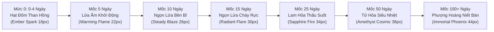

# Kế Hoạch [11]: Chuẩn Hóa Bộ Đếm Chuỗi Học Tập (Streak Engine) & Thiết Kế Lửa Tiến Hóa Đa Tầng (5, 10, 15, 25, 50, 100)

> **Trạng thái:** [Đang lên kế hoạch / Planning - Chờ phê duyệt từ người dùng]  
> **Ngày khởi tạo:** 13-11-2026  
> **Mục tiêu cốt lõi:**
> 1. Sửa chữa dứt điểm lỗi tính chuỗi ngày học hiện tại (đang bị hardcode 14 ngày, không đồng bộ theo từng tài khoản học viên và không lưu vào Supabase `profiles`).
> 2. Xây dựng thuật toán tính chuỗi chuẩn xác theo lịch dương thực tế: giữ chuỗi nếu học cùng ngày, tăng +1 khi học ngày kế tiếp, đứt chuỗi và reset khi cách từ 2 ngày trở lên.
> 3. Thiết lập hệ thống 6 cột mốc chuỗi then chốt: **5, 10, 15, 25, 50, 100 ngày**.
> 4. Xây dựng hệ thống Hoạt Ảnh Lửa Tiến Hóa (Progressive Flame Animation): Ngọn lửa thay đổi kích thước, hình thái SVG, màu sắc quang phổ (Cam $\rightarrow$ Đỏ $\rightarrow$ Lam Sapphire $\rightarrow$ Tím Thạch Anh $\rightarrow$ Cầu Vồng Phượng Hoàng) và hiệu ứng hạt lửa lấp lánh (Particle Sparks) lớn dần theo từng mốc.

---

## 1. Phân Tích Thực Trạng & Nguyên Nhân Lỗi Bộ Đếm Chuỗi Hiện Tại

Qua rà soát toàn bộ mã nguồn hiện tại, hệ thống tính chuỗi đang gặp **4 vấn đề lớn**:

1. **Dữ liệu mẫu bị đóng cứng (Hardcoded Mock State):**
   Trong [`src/hooks/useGamificationStore.ts`](file:///d:/Theodore/src/hooks/useGamificationStore.ts), giá trị mặc định đang bị gán cứng:
   ```ts
   streakCount: 14,
   totalXp: 850,
   currentLevel: 3
   ```
   Do lưu trong `localStorage` chung (`theodore_gamification`), bất kỳ người dùng nào (kể cả 5 tài khoản mới tinh vừa tạo) khi đăng nhập vào hệ thống đều bị hiển thị chuỗi 14 ngày, không phản ánh đúng tài khoản thực.
2. **Không đồng bộ với Supabase `profiles`:**
   Bảng `profiles` trong Supabase đã có sẵn các cột `streak_count`, `last_active_at`, `total_xp`. Tuy nhiên, khi kết thúc phiên giảng bài tại [`FeynmanStageLiveRoom.tsx`](file:///d:/Theodore/src/pages/FeynmanStageLiveRoom.tsx), hệ thống chỉ gọi store cục bộ mà không gửi lệnh `update` lên Supabase.
3. **Lỗ hổng logic tính ngày:**
   Hàm `calculateStreak` trong `gamification.ts` dùng `Math.max(1, currentStreak)` khi `diff === 0`, khiến tài khoản mới tinh (chuỗi = 0) bị ép ngay lên 1 ngày dù chưa hề học buổi nào. Đồng thời, `syncStreak` chưa được gọi tự động mỗi khi người dùng đăng nhập hoặc mở lại app.
4. **Ngọn lửa giao diện tĩnh (Static Icon):**
   Cả TopHeader và Dashboard hiện chỉ dùng duy nhất 1 icon SVG tĩnh `<Flame className="w-3.5 h-3.5 text-[#FFA929]" />` của Lucide. Dù người dùng đạt 1 ngày, 14 ngày hay 100 ngày thì hình dạng và màu sắc vẫn y hệt nhau, không có cảm giác tiến hóa hay thăng cấp.

---

## 2. Hệ Thống 7 Cấp Độ Lửa Tiến Hóa (Progressive Flame Architecture)

Mỗi cấp độ ngọn lửa được định nghĩa với thông số kích thước, màu sắc quang phổ, hoạt ảnh CSS Keyframes, hiệu ứng hạt và danh hiệu vinh danh độc bản:



### Bảng Chi Tiết Cấu Hình 7 Cấp Độ Lửa:

| Cột Mốc | Khoảng Ngày | Tên Hiển Thị & Danh Hiệu | Kích Thước | Dải Màu Gradient (CSS/SVG) | Hiệu Ứng Hoạt Ảnh (Animation & FX) |
|:---:|:---:|:---|:---:|:---|:---|
| **Mức 0** | **0 - 4 ngày** | *Tia Lửa Khởi Đầu*<br/>(Ember Spark) | `18px` | Cam nhạt $\rightarrow$ Vàng tro than<br/>`#F59E0B` $\rightarrow$ `#FDE68A` | Nhấp nháy nhẹ nhàng, biên độ chậm (`pulse` 2s), chưa có quầng sáng lớn. |
| **Mốc 5** | **5 - 9 ngày** | *Lửa Ấm Khởi Động*<br/>(Kindled Warming Flame) | `22px` | Vàng rực $\rightarrow$ Cam hổ phách<br/>`#FBBF24` $\rightarrow$ `#F97316` | Bắt đầu bốc ngọn lửa nhỏ, đung đưa góc 3 độ (`flame-sway`), viền hào quang mờ 1 lớp. |
| **Mốc 10** | **10 - 14 ngày** | *Ngọn Lửa Bền Bỉ*<br/>(Steady Golden Blaze) | `26px` | Cam tươi $\rightarrow$ Đỏ san hô<br/>`#F97316` $\rightarrow$ `#EA580C` | Lưỡi lửa kép uốn lượn, xuất hiện 2 tia đốm hạt lửa li ti bay lên (`rising-sparks`). |
| **Mốc 15** | **15 - 24 ngày** | *Ngọn Lửa Cháy Rực*<br/>(Radiant Crimson Flare) | `30px` | Đỏ rực $\rightarrow$ Đỏ thẫm năng lượng<br/>`#EF4444` $\rightarrow$ `#B91C1C` | Lửa bùng cháy mạnh mẽ với 3 lưỡi lửa đan xen, vầng hào quang kép tỏa nhiệt (`heatwave-glow`). |
| **Mốc 25** | **25 - 49 ngày** | *Lam Hỏa Thấu Suốt*<br/>(Sapphire Azure Fire) | `34px` | Xanh ngọc Cyan $\rightarrow$ Lam thấu suốt<br/>`#06B6D4` $\rightarrow$ `#2563EB` | Lửa chuyển sang **màu xanh lam** (nhiệt độ plasma cực cao), hạt sao điện từ lấp lánh xung quanh. |
| **Mốc 50** | **50 - 99 ngày** | *Tử Hỏa Siêu Nhiệt*<br/>(Amethyst Cosmic Flame) | `38px` | Tím thạch anh $\rightarrow$ Hồng dạ quang<br/>`#8B5CF6` $\rightarrow$ `#EC4899` | Lửa ma thuật tím vũ trụ, quầng năng lượng rung chấn (`cosmic-pulse`), 4 hạt tinh thể xoay quanh ngọn lửa. |
| **Mốc 100+** | **100+ ngày** | *Phượng Hoàng Niết Bàn*<br/>(Immortal Phoenix Flame) | `44px` | Cầu vồng quang phổ ngũ sắc hoàng kim<br/>`#F59E0B` $\rightarrow$ `#EC4899` $\rightarrow$ `#8B5CF6` $\rightarrow$ `#3B82F6` | **Đỉnh cao huyền thoại**: Cặp cánh lửa phượng hoàng vỗ nhịp ở hai bên ngọn lửa, vương miện hào quang ngũ sắc, pháo hoa hạt ánh sáng bung tỏa liên tục. |

---

## 3. Kiến Trúc Kỹ Thuật & Luồng Dữ Liệu

### 3.1. Thuật toán Tính Chuỗi Chuẩn Lịch (Calendar-Accurate Streak Engine)
Được chuẩn hóa trong [`src/lib/algorithms/gamification.ts`](file:///d:/Theodore/src/lib/algorithms/gamification.ts):
```ts
export interface StreakEvaluationResult {
  newStreak: number;
  streakIncremented: boolean;
  isFirstToday: boolean;
  isBroken: boolean;
  reachedMilestone: 5 | 10 | 15 | 25 | 50 | 100 | null;
  flameTier: FlameTierConfig;
}
```
* **Quy tắc tính khoảng cách ngày (`diff = today - lastActiveDate`):**
  * `diff === 0` *(Hôm nay đã học rồi)*: Giữ nguyên chuỗi hiện tại (`newStreak = currentStreak`), không tăng thêm để tránh spam phiên trong ngày.
  * `diff === 1` *(Hôm qua đã học, hôm nay hoàn thành bài học đầu tiên)*: Chuỗi tăng chính xác **+1** (`newStreak = currentStreak + 1`), kích hoạt thưởng XP Streak Bonus.
  * `diff > 1` *(Bỏ lỡ từ 2 ngày trở lên)*: Chuỗi bị đứt, reset về **1** khi hoàn thành bài giảng hôm nay.
  * *Tài khoản mới chưa từng học:* Chuỗi khởi đầu là **0**. Chỉ khi hoàn thành phiên giảng đầu tiên mới thành **1**.

### 3.2. Đồng Bộ Hóa 2 Chiều: Supabase $\leftrightarrow$ Zustand Store
1. **Khi Đăng Nhập / Tải Trang:**
   * Nạp `streak_count`, `last_active_at`, `total_xp` từ bảng `profiles` tương ứng với `user.id`.
   * Khởi tạo store Zustand riêng biệt theo ID người dùng: `elis_gamification_${user.id}`.
2. **Khi Hoàn Thành Bài Giảng (Bục Giảng Feynman):**
   * Tính toán chuỗi mới $\rightarrow$ Kiểm tra xem có vượt mốc `[5, 10, 15, 25, 50, 100]` không.
   * Cập nhật tức thời vào Zustand Store để cập nhật UI TopHeader & Dashboard.
   * Gửi RPC hoặc `upsert` cập nhật `streak_count = newStreak, last_active_at = now()` lên Supabase `profiles`.
   * Nếu đạt mốc mới $\rightarrow$ Bật Modal chúc mừng vinh danh `StreakMilestoneCelebrationModal` kèm hiệu ứng Confetti.

---

## 4. Các Thành Phần & Tệp Sẽ Tạo / Nâng Cấp

### 1. Tệp Mới Dự Kiến:
1. `src/config/streak-milestones.config.ts`:
   * Định nghĩa cấu hình 7 cấp độ ngọn lửa (màu sắc gradient, SVG paths, hiệu ứng hạt, danh hiệu tiếng Việt).
   * Danh sách 6 mốc: `[5, 10, 15, 25, 50, 100]`.
2. `src/components/gamification/StreakFlameBadge.tsx`:
   * Component ngọn lửa SVG đa tầng tiến hóa:
     * Lớp 1: Quầng sáng nền (Aura Glow Background)
     * Lớp 2: Thân lửa chính (Main Flame Path & Gradient)
     * Lớp 3: Lõi lửa nhiệt năng (Core Inner Flame)
     * Lớp 4: Các hạt tia lửa bay lên (Sparks Particles)
     * Lớp 5 (Cho mốc 100): Đôi cánh phượng hoàng & Vương miện hoàng kim.
   * Hỗ trợ tooltip chi tiết hiển thị: Cột mốc hiện tại, số ngày còn thiếu để tiến hóa ngọn lửa cấp tiếp theo.
3. `src/components/gamification/StreakMilestoneCelebrationModal.tsx`:
   * Modal vinh danh toàn màn hình xuất hiện khi học viên vượt mốc 5, 10, 15, 25, 50, 100 ngày.
   * Hiệu ứng pháo hoa Confetti, hoạt ảnh ngọn lửa mới bùng cháy to lớn và nút "Tiếp tục rèn luyện".

### 2. Tệp Cần Chỉnh Sửa & Tối Ưu:
4. `src/lib/algorithms/gamification.ts`:
   * Viết lại hàm `calculateStreak` chuẩn hóa mốc 0 ngày, kiểm tra milestone vượt cấp.
5. `src/hooks/useGamificationStore.ts`:
   * Xóa bỏ hoàn toàn giá trị giả lập 14 ngày.
   * Đổi key lưu trữ theo `user.id`: `elis_gamification_${userId}`.
   * Bổ sung hàm `loadFromProfile(profile)` để nạp trực tiếp dữ liệu từ Supabase khi đăng nhập.
6. `src/components/layout/TopHeader.tsx`:
   * Thay thế icon Lucide `<Flame />` tĩnh bằng component tiến hóa `<StreakFlameBadge streakCount={streakCount} />`.
7. `src/pages/CommandDashboard.tsx`:
   * Nâng cấp thẻ thống kê Chuỗi Rèn Luyện ở giữa màn hình: hiển thị ngọn lửa lớn với cấp độ tương ứng, thanh tiến trình (Progress Bar) % ngày đạt đến ngọn lửa kế tiếp.
8. `src/pages/FeynmanStageLiveRoom.tsx`:
   * Gọi lưu kết quả chuỗi lên Supabase `profiles` khi kết thúc phiên.

---

## 5. Tiêu Chí Nghiệm Thu (Acceptance Criteria)

- [ ] Tài khoản mới tinh (ví dụ `minhanh_it`) khi đăng nhập hiển thị đúng **0 ngày**, ngọn lửa ở trạng thái tia lửa nhỏ 18px.
- [ ] Khi hoàn thành 1 bài giảng lần đầu tiên trong ngày, chuỗi tăng chính xác từ 0 lên 1 ngày.
- [ ] Khi học tiếp bài giảng thứ 2 trong cùng ngày, chuỗi được giữ nguyên (không bị cộng dồn sai).
- [ ] Hoạt ảnh ngọn lửa biến đổi mượt mà và trực quan qua 7 giai đoạn:
  - 0-4 ngày: Tia lửa cam than hồng 18px
  - 5-9 ngày: Lửa ấm 22px
  - 10-14 ngày: Lửa bền bỉ cam tươi 26px kèm hạt lửa bay
  - 15-24 ngày: Lửa đỏ rực 30px tỏa nhiệt
  - 25-49 ngày: Lửa xanh lam Sapphire 34px
  - 50-99 ngày: Lửa tím vũ trụ Amethyst 38px
  - 100+ ngày: Lửa Phượng hoàng cầu vồng 44px
- [ ] Khi chạm đúng các mốc **5, 10, 15, 25, 50, 100**, modal chúc mừng xuất hiện vinh danh học viên.
- [ ] Dữ liệu chuỗi được lưu trữ đồng bộ vào Supabase `profiles.streak_count` và khôi phục chính xác khi đổi tài khoản hoặc F5 trình duyệt.

