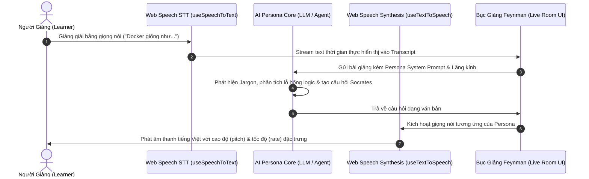

# Kế Hoạch [7]: Hệ Thống Hội Thoại Giọng Nói Hai Chiều (Speech-to-Speech AI Personas)

> **Trạng thái:** [Đã hoàn thành / Completed]  
> **Ngày khởi tạo:** 07-11-2026  
> **Ngày hoàn thành:** 13-11-2026  
> **Mục tiêu cốt lõi:** Thiết lập chu trình hội thoại bằng âm thanh hai chiều (Speech-to-Speech) trên bục giảng Feynman: Người học dùng giọng nói để giảng giải, Khán giả AI (Bé Bắp, Chị Mai, Bác Năm, Shark Tuấn...) tự động cất giọng nói tiếng Việt phản biện và đặt câu hỏi lại.

---

## 1. Tổng Quan Kiến Trúc Vòng Lặp Hội Thoại (Speech-to-Speech Loop)

---

## 2. Lộ Trình Triển Khai Chi Tiết (Frontend First, Backend Khi Cần)

### Giai Đoạn 1: Giải Pháp Browser-Native (Đã Hoàn Thành - 0đ Chi Phí, Không Độ Trễ)
Sử dụng chuẩn W3C **Web Speech API - SpeechSynthesis** tích hợp sẵn trong trình duyệt.

1. **Tạo Hook chuyên dụng `src/hooks/useTextToSpeech.ts`:**
   - Quản lý danh sách voice tiếng Việt của hệ thống (`vi-VN`, ví dụ: *Google Tiếng Việt*, *Microsoft Hoài My*, *Microsoft Nam*).
   - Hàm `speak(text: string, options: PersonaVoiceOptions)`.
   - Trạng thái `isSpeaking`, `pause()`, `resume()`, `stop()`.
   - Cơ chế tự động giải phóng bộ nhớ và hủy lời nói cũ khi có câu nói mới.
   - Lưu trữ tùy chọn `autoSpeak`, `isMuted`, `selectedVoiceURI` bền vững qua `localStorage` (`theodore_tts_settings_v1`).

2. **Bản đồ cấu hình giọng nói theo từng Khán giả AI (`persona-voice.config.ts`):**
   - **Bé Bắp (10 tuổi):** `pitch = 1.45`, `rate = 1.05` $\rightarrow$ Giọng trẻ con thanh cao, tò mò, nói lanh lợi.
   - **Chị Mai (29 tuổi - Nhân sự):** `pitch = 1.08`, `rate = 1.0` $\rightarrow$ Giọng nữ công sở chuẩn mực, lịch thiệp.
   - **Bác Năm (58 tuổi - Nông dân):** `pitch = 0.78`, `rate = 0.85` $\rightarrow$ Giọng nam trầm, ấm áp, nhịp điệu từ tốn.
   - **Shark Tuấn (42 tuổi - Nhà đầu tư):** `pitch = 0.92`, `rate = 1.12` $\rightarrow$ Giọng dứt khoát, sắc bén, tốc độ hơi nhanh.
   - **Khán giả tùy chỉnh (Custom Persona):** Tự động suy ra `pitch` dựa vào độ tuổi và `rate` dựa vào mức độ hoài nghi (Skepticism Slider).
   - Hàm `cleanTextForSpeech` loại bỏ markdown, code, emoji và thẻ kỹ thuật trước khi đưa vào synthesizer.

3. **Tích hợp vào Bục Giảng ([`FeynmanStageLiveRoom.tsx`](file:///d:/Theodore/src/pages/FeynmanStageLiveRoom.tsx)):**
   - Nút bật/tắt âm thanh AI: `Bật tiếng / Tắt tiếng (Mute/Unmute)`.
   - Tùy chọn `Tự động đọc phản hồi (Auto-speak)` khi AI gửi câu hỏi.
   - Nút icon loa nhỏ trên từng bong bóng chat của AI để người học có thể bấm nghe lại bất cứ lúc nào.
   - Khử nhiễu micro hai chiều: Bấm mic tự động dập tắt TTS đang phát để tránh micro thu lại tiếng AI.

4. **Tích hợp vào Landing Page Live Trial ([`FeynmanLiveTrialModule.tsx`](file:///d:/Theodore/src/components/landing/FeynmanLiveTrialModule.tsx)):**
   - Giọng đọc Bé Bắp tự động cất lên khi AI trả lời hoặc khi bấm nút "Nghe Bé Bắp nói" trên bong bóng chat.
   - Nút bật/tắt giọng Bé Bắp nhanh trên thanh tiêu đề Live Trial.

5. **Trang Cấu hình ([`SettingsAndAIConfig.tsx`](file:///d:/Theodore/src/pages/SettingsAndAIConfig.tsx)):**
   - Dropdown chọn giọng tiếng Việt ưu tiên.
   - Bảng nghe thử mẫu giọng nói của 4 Persona mặc định (Bé Bắp, Chị Mai, Bác Năm, Shark Tuấn).
   - Công tắc Auto-Speak và Mute toàn hệ thống.

---

### Giai Đoạn 2: Giải Pháp Nâng Cao (Full Duplex Realtime Stream - Dự Kiến Tương Lai)
*Tùy chọn nâng cấp cho tương lai khi cần biểu cảm giọng nói chân thực tối đa:*

1. **Gemini Multimodal Live API (hoặc OpenAI Realtime API):**
   - Truyền nhận trực tiếp luồng Audio qua WebSocket (`pcm16` 24kHz).
   - Tự động ngắt lời (Barge-in / Interruption handling): Khi người học cất giọng, AI ngay lập tức ngừng nói để lắng nghe.
2. **Backend TTS Proxy (`FastAPI`):**
   - Kết nối Edge-TTS hoặc Faster-Whisper nếu cần hỗ trợ các trình duyệt cũ không hỗ trợ Web Speech API.

---

## 3. Danh Sách Các File Đã Tạo & Chỉnh Sửa

### Files Mới Đã Tạo:
1. `src/hooks/useTextToSpeech.ts`: Hook xử lý Text-to-Speech native, tracking speaking state & message ID.
2. `src/config/persona-voice.config.ts`: Mapping thông số âm thanh (pitch, rate, voiceName) cho từng Persona & hàm cleanTextForSpeech.

### Files Đã Chỉnh Sửa:
3. `src/pages/FeynmanStageLiveRoom.tsx`: Gắn trigger đọc âm thanh khi nhận tin nhắn phản hồi của AI, toggle Auto-Speak, ngắt TTS khi thu âm.
4. `src/components/stage/ChatTranscript.tsx`: Bổ sung nút nghe lại (Speaker icon) với animation sóng âm trên từng tin nhắn AI.
5. `src/components/landing/FeynmanLiveTrialModule.tsx`: Tích hợp giọng nói Bé Bắp, nút nghe lại và toggle giọng AI.
6. `src/pages/SettingsAndAIConfig.tsx`: Thêm thẻ cấu hình giọng đọc Web Speech, nghe thử mẫu giọng và thiết lập Auto-speak/Mute.

---

## 4. Tiêu Chí Nghiệm Thu (Acceptance Criteria)
- [x] Người dùng nói qua Micro $\rightarrow$ Văn bản được nhận diện chính xác qua `useSpeechToText`.
- [x] AI Persona trả lời $\rightarrow$ Tự động cất giọng nói tiếng Việt chuẩn.
- [x] Giọng của Bé Bắp khác biệt rõ rệt với giọng của Bác Năm và Shark Tuấn thông qua các tham số pitch/rate.
- [x] Có nút tắt tiếng (Mute) ngay trên giao diện phòng giảng, không bắt buộc người học phải luôn nghe âm thanh.
- [x] Hoạt động trơn tru không gây xung đột micro/loa (hủy TTS trước khi kích hoạt STT nếu người học bắt đầu nói).

