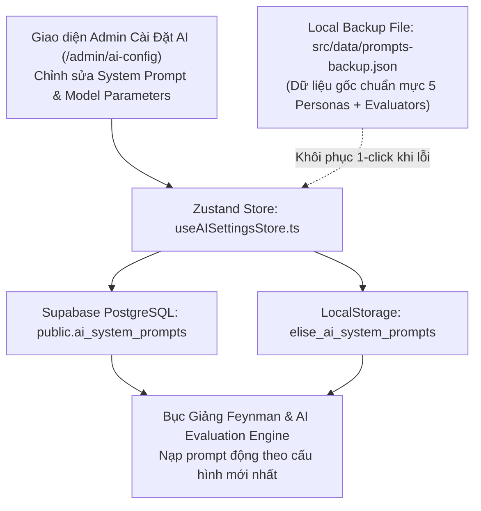

# Kế Hoạch [10]: Hệ Thống Cài Đặt AI & Quản Lý System Prompts (AI Settings & Prompts Studio)

> **Trạng thái:** Đã hoàn thành (v[10])  
> **Ngày hoàn tất:** 07-11-2026  
> **Mục tiêu cốt lõi:**
> 1. **Dọn dẹp UI Quản trị:** Xóa bỏ thanh tab phụ `AdminSubNav` trên đầu các trang admin theo yêu cầu người dùng.
> 2. **Tái cấu trúc danh mục:** Thay thế tên gọi "Khán giả AI" thành **"Cài Đặt AI"** trong phân hệ Admin và toàn hệ thống.
> 3. **Xây dựng Trang Quản trị "Cài Đặt AI" (`/admin/ai-config`):**
>    - Cho phép Admin xem, chỉnh sửa, thử nghiệm và lưu trữ trực tiếp các **System Prompts** của từng nhân vật AI Persona (Bé Bắp, Chị Mai, Bác Năm, Shark Tuấn...) và Bộ máy đánh giá (Layer 1 Evaluator, Socratic Questioner).
>    - Điều chỉnh các thông số suy luận: `model`, `temperature`, `max_tokens`, `top_p`, `skepticism_level`.
> 4. **Lưu trữ đa tầng (Database + Local Backup):**
>    - **Database (Bảng thứ 14):** `public.ai_system_prompts` trong Supabase PostgreSQL & Prisma Schema.
>    - **Local Backup:** File JSON dự phòng chuẩn mực (`src/data/prompts-backup.json`) + LocalStorage (`elise_ai_system_prompts`) qua Zustand store, đảm bảo offline-first và khôi phục 1-click khi cần.

---

## 1. Thiết Kế Cơ Sở Dữ Liệu: Bảng `ai_system_prompts` (Bảng thứ 14)

```sql
CREATE TABLE IF NOT EXISTS public.ai_system_prompts (
    id TEXT PRIMARY KEY,                       -- e.g. 'prompt-child-10yo', 'prompt-evaluator-engine'
    prompt_key TEXT UNIQUE NOT NULL,           -- e.g. 'PERSONA_CHILD_10YO', 'EVALUATION_LAYER1'
    title TEXT NOT NULL,                       -- Tên hiển thị (VD: "Bé Bắp 10 tuổi - Tò Mò Hồn Nhiên")
    category TEXT NOT NULL CHECK (category IN ('PERSONA', 'EVALUATOR', 'SOCRATIC', 'SYSTEM')),
    system_prompt TEXT NOT NULL,               -- Nội dung chỉ dẫn prompt
    parameters JSONB NOT NULL DEFAULT '{
        "model": "gemini-1.5-flash",
        "temperature": 0.7,
        "max_tokens": 1024,
        "top_p": 0.95,
        "skepticism_level": 5
    }'::jsonb,
    is_active BOOLEAN DEFAULT TRUE,
    version INT DEFAULT 1,
    updated_at TIMESTAMPTZ DEFAULT NOW()
);

-- Index tra cứu nhanh theo prompt_key
CREATE INDEX IF NOT EXISTS idx_ai_prompts_key ON public.ai_system_prompts(prompt_key);
```

---

## 2. Kiến Trúc Luồng Dữ Liệu & Đồng Bộ (Data Flow)



---

## 3. Danh Sách Các File Cần Tạo & Chỉnh Sửa

### A. Xóa Bỏ & Tinh Chỉnh UI Hiện Tại:
1. `src/pages/admin/AdminRubricStudio.tsx`: Bỏ `<AdminSubNav />`.
2. `src/pages/admin/AdminAuditCenter.tsx`: Bỏ `<AdminSubNav />`.
3. `src/pages/admin/AdminCurriculumManager.tsx`: Bỏ `<AdminSubNav />`.
4. `src/components/admin/AdminSubNav.tsx`: Xóa bỏ file component không còn sử dụng.

### B. Cơ Sở Dữ Liệu & Local Backup:
5. `prisma/schema.prisma`: Thêm model `AISystemPrompt`.
6. `supabase/seed.sql`: Thêm DDL bảng `public.ai_system_prompts` và dữ liệu seed mặc định.
7. `src/data/prompts-backup.json`: File JSON dự phòng cục bộ chứa toàn bộ system prompts gốc của:
   - `PERSONA_CHILD_10YO` (Bé Bắp 10 tuổi)
   - `PERSONA_NON_TECH` (Chị Mai 29 tuổi - Trái ngành)
   - `PERSONA_FARMER` (Bác Năm 58 tuổi - Nông dân)
   - `PERSONA_INVESTOR` (Shark Tuấn 42 tuổi - Nhà đầu tư)
   - `PERSONA_GRANDMA` (Bà Ngoại 70 tuổi)
   - `EVALUATION_LAYER1` (Bộ máy bóc tách Jargon & Logic Gap)
   - `SOCRATIC_PROBE` (Bộ máy đặt câu hỏi truy vấn sâu)
8. `src/types/ai-config.types.ts`: TypeScript contracts cho prompt, tham số và danh mục.
9. `src/hooks/useAISettingsStore.ts`: Zustand store quản lý CRUD prompts, đồng bộ Supabase + LocalStorage + khôi phục từ file backup.

### C. Giao Diện Quản Trị Mới:
10. `src/pages/admin/AdminAISettings.tsx`: Giao diện Cài Đặt AI Master-Detail:
    - Cột trái: Phân loại theo tabs (`Khán Giả AI`, `Bộ Chấm Điểm Evaluator`, `Phản Biện Socratic`), danh sách prompts với tag model và nhiệt độ temperature.
    - Cột phải: Editor chuyên nghiệp: Tên, Phân loại, Sliders tham số (Temperature, Max Tokens, Độ hoài nghi), Textarea soạn thảo System Prompt kèm gợi ý biến (`{{topic}}`, `{{required_concepts}}`), nút "Lưu Hệ Thống", "Khôi Phục Bản Gốc", "Test Nhanh Prompt".
11. `src/config/routes.config.ts`: Đổi `Khán Giả AI` thành `Cài Đặt AI` (`/admin/ai-config`) với icon `Bot`.
12. `src/components/layout/AppSidebar.tsx` & `src/App.tsx`: Đăng ký route mới `/admin/ai-config`.
