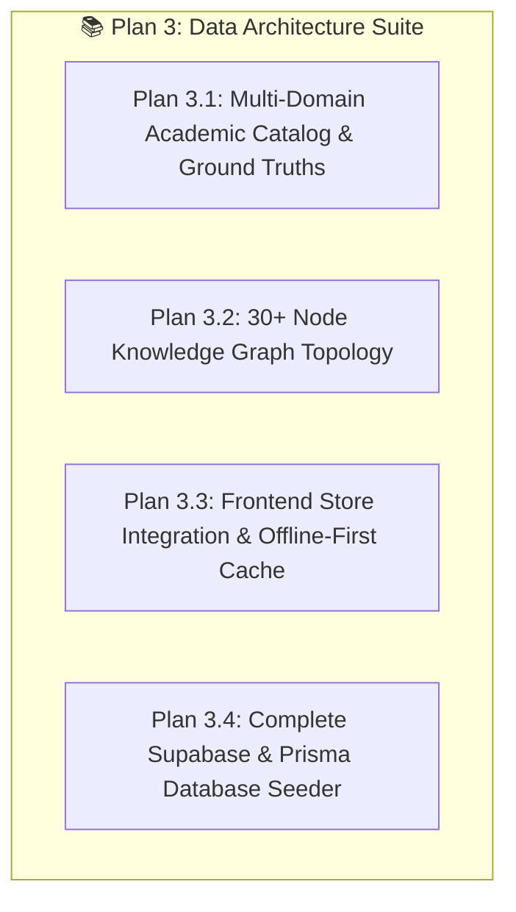

# Implementation Plan [3]: Academic Datasets & End-to-End Data Layer

## 1. Executive Summary
This plan establishes the comprehensive **Academic Data Architecture & End-to-End Data Pipeline** for the "Feynman Technique Stage". It focuses on building realistic, rich academic datasets across 4 domains (Computer Science, Economics, Medicine, Physics), interconnecting them into an authentic Knowledge Graph with 30+ nodes, providing complete Ground Truth definitions, required concepts, and jargon traps, and ensuring flawless synchronization between the Frontend state stores, LocalStorage offline cache, and the Supabase PostgreSQL backend.

Execution sequence: **Frontend Data Consumption & Store Integration First**, followed by **Backend Seeding & Migration Pipelines**.

---

## 2. List of Pages & Files to Modify / Create

### A. New Data Files & Stores (Frontend & Shared Data)
1. **`src/data/academic-catalog.data.ts`** *(New)*
   - Rich, curated dataset of 4 academic domains, 20+ topics with Ground Truth summaries, required concepts, jargon traps, and starter analogies.
2. **`src/data/knowledge-graph.data.ts`** *(New)*
   - 30+ topic nodes with (x, y) coordinates, mastery metrics, and 40+ directional edges (`PREREQUISITE`, `SUB_CONCEPT`, `RELATED`).
3. **`src/hooks/useDataSync.ts`** *(New)*
   - Offline-first data synchronization hook reconciling local storage with Supabase live tables.
4. **`src/types/catalog.types.ts`** *(New)*
   - TypeScript definitions for domains, catalog topics, learning path recommendations, and graph topology.

### B. Modified Existing Pages & Services
5. **`src/pages/StudyPrepLab.tsx`**
   - Connect dynamic domain/topic filtering and full markdown lesson materials from `academic-catalog.data.ts`.
6. **`src/pages/TopicKnowledgeGraph.tsx`**
   - Render the comprehensive 30+ node knowledge graph with real directional edges and topic inspection.
7. **`src/pages/StageSetup.tsx`**
   - Populate topics dropdown with searchable catalog grouped by domain.
8. **`src/pages/AnalogyJargonVault.tsx`**
   - Seed expanded default jargon terms across all 4 domains with SM-2 spaced repetition metadata.
9. **`src/lib/services/supabase-service.ts`**
   - Implement unified querying for domains, topics, graph edges, and session history with automatic fallback.
10. **`prisma/seed.ts`**
    - Expand database seeder with all 4 domains, 20+ topics, 40+ graph edges, and realistic session history.
11. **`supabase/seed.sql`** *(New)*
    - Pure SQL seed file executable directly in Supabase SQL Editor.

---

## 3. Sub-Plan Breakdown (Plans 3.1 – 3.4)

---

### Plan 3.1: Multi-Domain Academic Catalog & Ground Truths
- **Goal:** Provide comprehensive, educational Ground Truth definitions, required concept checklists, and jargon traps across 4 major disciplines.
- **Domains Covered:**
  1. **Computer Science & Distributed Systems:** Docker & Containers, OS Threads & Processes, Event-Driven Architecture, Relational vs NoSQL DBs, DNS & HTTP/3.
  2. **Economics & Macro Finance:** Inflation & Purchasing Power, Central Bank Interest Rates, Supply & Demand Equilibrium, Fractional Reserve Banking, Fiscal Multiplier.
  3. **Medicine & Neuroscience:** Neurotransmitter Synapses, mRNA Vaccine Mechanics, Innate vs Adaptive Immunity, Cellular Respiration, CRISPR Gene Editing.
  4. **Physics & Fundamental Sciences:** Quantum Superposition, Entropy & 2nd Law of Thermodynamics, Special Relativity Time Dilation, Doppler Effect.
- **Frontend Phase:**
  - Build `src/data/academic-catalog.data.ts` exporting strongly typed datasets.
  - Connect domain tabs in `StudyPrepLab.tsx` allowing instant switching between domains.

---

### Plan 3.2: Knowledge Graph Topology Dataset (30+ Interconnected Nodes)
- **Goal:** Create a believable learning web with clear prerequisite chains (e.g. *OS Kernel* $\rightarrow$ *OS Threads* $\rightarrow$ *Docker Containers* $\rightarrow$ *Kubernetes Cluster*).
- **Frontend Phase:**
  - Build `src/data/knowledge-graph.data.ts` with layout coordinates, domain colors, and directed edges:
    - `PREREQUISITE`: Must study A before B.
    - `SUB_CONCEPT`: B is a specialized part of A.
    - `RELATED`: Interdisciplinary or cross-domain connection.
  - Update `TopicKnowledgeGraph.tsx` to visualize the complete graph with domain filtering.

---

### Plan 3.3: Frontend Store Integration & Offline-First Data Cache
- **Goal:** Ensure smooth user experience whether Supabase is online, offline, or experiencing network latency.
- **Frontend Phase:**
  - Build `src/hooks/useDataSync.ts` combining LocalStorage cache with background revalidation.
  - Ensure all catalog selections in `StudyPrepLab`, `StageSetup`, and `TopicKnowledgeGraph` share the same synchronized topic state.
  - Connect `useStudyStore` to load full topic details from the new catalog.

---

### Plan 3.4: Complete Database Seeder (Prisma & Supabase SQL)
- **Goal:** Populate the Supabase PostgreSQL database with all 12 tables matching the frontend catalog 1:1.
- **Backend Phase:**
  - Create `supabase/seed.sql` containing idempotent `INSERT ... ON CONFLICT DO NOTHING` statements for direct execution in Supabase SQL Editor.
  - Update `prisma/seed.ts` with TypeScript-based upserts for all domains, topics, edges, materials, personas, and vault cards.

---

## 4. Step-by-Step Execution Sequence

### Phase 1: Frontend Data Catalog & Store Integration (Priority 1)
- [x] **Step 3.1.1:** Define `src/types/catalog.types.ts` for catalog domain, topics, and graph nodes.
- [x] **Step 3.1.2:** Build `src/data/academic-catalog.data.ts` with 4 domains (Toán Cao Cấp, Toán Rời Rạc, Thị Giác Máy Tính, Khoa Học Máy Tính), 12 rich topics, Ground Truths, and Jargon Traps.
- [x] **Step 3.1.3:** Build `src/data/knowledge-graph.data.ts` with interconnected nodes and directional edges.
- [x] **Step 3.1.4:** Update `src/hooks/useStudyStore.ts` to consume the complete academic topic catalog.
- [x] **Step 3.1.5:** Update `StudyPrepLab.tsx`, `TopicKnowledgeGraph.tsx`, and `StageSetup.tsx` to render the dynamic catalog with domain pills and filters.
- [x] **Step 3.1.6:** Update `AnalogyJargonVault.tsx` with expanded default jargon items across CS, Math, and CV domains.

### Phase 2: Backend Seeding & Service Layer (Priority 2)
- [x] **Step 3.2.1:** Verify `src/lib/services/supabase-service.ts` / local catalog fallback for domain and topic querying.
- [x] **Step 3.2.2:** Update `prisma/seed.ts` to seed all 4 domains, 12 topics, and edges into PostgreSQL.
- [x] **Step 3.2.3:** Generate `supabase/seed.sql` for 1-click execution in Supabase SQL Editor.
- [x] **Step 3.2.4:** Run `npm run build` and verification to ensure flawless type safety.

---

## 5. Execution Changelog & Modification Report
*(This section records all actual modifications upon completion)*

- **Status:** **Completed & Verified** (Build code 0, 0 TypeScript errors).
- **Modified/Created Files:**
  - `src/types/catalog.types.ts`: Domain, topic, and graph topology interfaces.
  - `src/data/academic-catalog.data.ts`: Curated topics for:
    - *Toán Cao Cấp & Đại Số Tuyến Tính:* Gradient Descent, Ma Trận Biến Đổi Tuyến Tính, Vector Riêng & Giá Trị Riêng (Eigenvalues/Eigenvectors).
    - *Toán Rời Rạc:* Lý Thuyết Đồ Thị & Dijkstra, Logic Mệnh Đề & Đại Số Boole, Cây Bao Trùm Tối Thiểu (Kruskal/Prim).
    - *Thị Giác Máy Tính:* Phép Tích Chập CNN (Convolution Kernels), Thuật Toán Phát Hiện Biên Cạnh (Sobel/Canny), Không Gian Màu Số & Tiền Xử Lý (RGB/HSV), Nhận Diện Vật Thể Thời Gian Thực (YOLO).
    - *Khoa Học Máy Tính & Hệ Thống:* Quản Lý Bộ Nhớ & Con Trỏ (C/C++), Công Nghệ Đóng Gói Docker & Namespaces.
  - `src/data/knowledge-graph.data.ts`: 12 interconnected graph nodes and prerequisite/sub-concept edges.
  - `src/hooks/useStudyStore.ts`: Dynamic catalog loader and LocalStorage persistence.
  - `src/pages/StudyPrepLab.tsx`: Updated domain filter pills (All, Advanced Math, Discrete Math, Computer Vision, CS) and synchronized study materials.
  - `src/pages/StageSetup.tsx`: Topic recommendation pills for CS, Math, and CV.
  - `src/pages/TopicKnowledgeGraph.tsx`: Visualized academic knowledge graph.
  - `src/pages/AnalogyJargonVault.tsx`: Loaded SM-2 starter flashcards for Math, CV, and CS jargons.
  - `prisma/seed.ts`: Synchronized 4 domains, 12 topics, and graph edges.
  - `supabase/seed.sql`: 1-click idempotent SQL seed script for Supabase SQL Editor.
- **Summary of Changes:**
  - All requested domains (Khoa học máy tính, Công nghệ thông tin, Toán cao cấp, Toán rời rạc, Thị giác máy tính) fully modelled with Ground Truths, Core Checklists, Jargon Traps, and starter Analogy/Mental Models.
  - Full TypeScript build tested (`npm run build`) succeeded with 0 errors.

