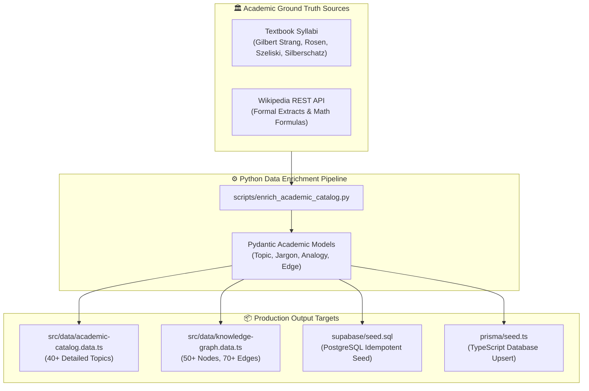

# Implementation Plan [4]: Academic Data Enrichment & Syllabus Pipeline

## 1. Executive Summary
This plan details the exact academic sources, methodology, and technical pipeline for enriching the "Feynman Technique Stage" dataset with **high-volume, academically rigorous, and verified knowledge** across:
1. **Toán Cao Cấp & Đại Số Tuyến Tính (Advanced Mathematics & Linear Algebra)**
2. **Toán Rời Rạc (Discrete Mathematics & Graph Theory)**
3. **Thị Giác Máy Tính (Computer Vision & Deep Learning for Vision)**
4. **Khoa Học Máy Tính & Hệ Thống (Computer Science & Operating Systems)**

### Ground Truth Data Sources:
1. **Peer-Reviewed Reference Standards (Gold Standard Textbooks & Course Syllabi):**
   - *Advanced Math:* MIT 18.06 (Gilbert Strang - Linear Algebra), James Stewart (Calculus).
   - *Discrete Math:* Kenneth H. Rosen (*Discrete Mathematics and Its Applications*), MIT 6.042J.
   - *Computer Vision:* Richard Szeliski (*Computer Vision: Algorithms & Applications*), Stanford CS231n.
   - *Computer Science:* Silberschatz, Galvin, Gagne (*Operating System Concepts*), Cormen et al. (*CLRS Algorithms*).
2. **Open Encyclopedic Knowledge Graph (Wikipedia REST API & DBpedia):**
   - Programmatically fetch formal summaries, mathematical definitions, and canonical citations with zero hallucination.
3. **Feynman Technique Structural Layer:**
   - Transforming formal definitions into the 4 mandatory Feynman pedagogical facets:
     - `Ground Truth`: Formal mathematical/technical definition.
     - `Core Concepts Checklist`: Mandatory components a student must explain.
     - `Jargon Traps`: Common buzzwords used without understanding, with the correct intuitive translation.
     - `Analogy / Mental Model`: Everyday physical metaphor (explain to a 5-year-old or non-specialist).

---

## 2. Target File Structure & Pipeline Architecture

---

## 3. Scope of Topics (40+ Academic Concepts)

### A. Toán Cao Cấp & Đại Số Tuyến Tính (10 Topics)
1. **Gradient Descent & Tối Ưu Hóa Hàm Nhiều Biến** (Loss surface, gradient vector, learning rate)
2. **Ma Trận Biến Đổi Tuyến Tính & Không Gian Vector** (Basis, Span, Kernel, Rank-Nullity)
3. **Eigenvalues & Eigenvectors (Trị Riêng & Vector Riêng)** (Phương trình đặc trưng, biến đổi không gian)
4. **Phép Phân Tích SVD (Singular Value Decomposition)** (Nén dữ liệu, ma trận trực giao $U, \Sigma, V^T$)
5. **Ma Trận Hessian & Điểm Yên Ngựa (Saddle Points)** (Đạo hàm riêng cấp hai, cực trị địa phương)
6. **Chuỗi Taylor & Xấp Xỉ Đa Thức** (Taylor expansion, phần dư Lagrange)
7. **Phép Khử Gauss-Jordan & Nghịch Đảo Ma Trận** (Hàng bậc thang, nghiệm hệ phương trình)
8. **Tích Phân Bội (Double/Triple Integrals) & Định Lý Green** (Diện tích, thể tích, trường vector)
9. **Phép Biến Đổi Fourier Liên Tục & Rời Rạc (DFT/FFT)** (Miền tần số, sóng điều hòa)
10. **Không Gian Tích Trong & Trực Giao Hóa Gram-Schmidt** (Chuẩn hóa vector, khoảng cách Euclidean)

### B. Toán Rời Rạc & Lý Thuyết Đồ Thị (10 Topics)
11. **Lý Thuyết Đồ Thị & Thuật Toán Dijkstra** (Đường đi ngắn nhất, ma trận kề, hàng đợi ưu tiên)
12. **Cây Bao Trùm Tối Thiểu (Kruskal & Prim)** (Disjoint Set Union, chu trình đồ thị, greedy algorithm)
13. **Logic Mệnh Đề & Đại Số Boole** (Luật De Morgan, bảng chân trị, dạng chuẩn tắc tuyển/hội)
14. **Quy Nạp Toán Học & Đệ Quy** (Cơ sở quy nạp, bước quy nạp, hệ thức truy hồi)
15. **Quan Hệ Tương Đương & Lớp Tương Đương** (Tính phản xạ, đối xứng, bắc cầu, phân hoạch tập hợp)
16. **Nguyên Lý Dirichlet (Pigeonhole Principle)** (Đếm tổ hợp, chứng minh sự tồn tại)
17. **Chu Trình Euler & Chu Trình Hamilton** (Bậc đỉnh đồ thị, bài toán 7 cây cầu Königsberg, NP-Complete)
18. **Thuật Toán Tìm Kiếm Theo Chiều Rộng & Sâu (BFS/DFS)** (Cây duyệt, tìm thành phần liên thông, topological sort)
19. **Tô Màu Đồ Thị & Bài Toán Bốn Màu (Four Color Theorem)** (Số màu sắc, bài toán xếp lịch)
20. **Tổ Hợp & Chỉnh Hợp (Combinatorics & Binomial Theorem)** (Quy tắc cộng, quy tắc nhân, tam giác Pascal)

### C. Thị Giác Máy Tính (Computer Vision) (10 Topics)
21. **Phép Tích Chập 2D & Mạng CNN (Convolutional Neural Networks)** (Kernel/Filter, Stride, Padding, Receptive Field)
22. **Thuật Toán Phát Hiện Biên Cạnh Canny & Sobel** (Gradient hình ảnh, Non-maximum suppression, Hysteresis thresholding)
23. **Không Gian Màu & Biến Đổi Hình Thái Học (Morphology)** (RGB, HSV, Grayscale, Dilation, Erosion, Otsu Threshold)
24. **Nhận Diện Vật Thể Thời Gian Thực YOLO** (Single-shot detector, Anchor boxes, IoU, Bounding Box regression)
25. **Thuật Toán Trích Xuất Đặc Trưng SIFT & Harris Corner** (Điểm góc, bất biến tỷ lệ, xoay)
26. **Phép Biến Đổi Hough (Hough Transform)** (Phát hiện đường thẳng, đường tròn trong không gian tham số)
27. **Residual Networks (ResNet) & Skip Connections** (Vanishing gradient, học phần dư $F(x) + x$)
28. **Phân Vùng Ảnh Ngữ Nghĩa U-Net (Semantic Segmentation)** (Encoder-Decoder, Skip connections, Pixel-level classification)
29. **Dòng Quang Học (Optical Flow - Lucas-Kanade)** (Ước lượng chuyển động vector điểm ảnh, gradient thời gian)
30. **Vision Transformer (ViT) & Self-Attention trong Ảnh** (Patch extraction, Positional embedding, Multi-head attention)

### D. Khoa Học Máy Tính & Hệ Thống (10 Topics)
31. **Quản Lý Bộ Nhớ C/C++ & Con Trỏ (Pointers & Memory)** (Stack vs Heap, Segmentation Fault, Pointer arithmetic, Memory Leak)
32. **Đóng Gói Ứng Dụng Docker, Linux Namespaces & Cgroups** (Isolated process, Layered filesystem, Isolation vs Virtualization)
33. **Tiến Trình vs Luồng (Process vs Thread & Concurrency)** (PCB, Context switch, Mutex, Semaphore, Race conditions)
34. **Deadlock & Bốn Điều Kiện Coffman** (Mutual exclusion, Hold and wait, No preemption, Circular wait, Banker's algorithm)
35. **Bộ Nhớ Ảo & Phân Trang (Virtual Memory & Paging)** (Page tables, TLB, Page fault, LRU cache replacement)
36. **Giao Thức Bắt Tay 3 Bước TCP (TCP 3-Way Handshake)** (SYN, SYN-ACK, ACK, Flow control, Congestion window)
37. **Hệ Thống Phân Tán & Định Lý CAP (CAP Theorem)** (Consistency, Availability, Partition tolerance, BASE vs ACID)
38. **Cơ Sở Dữ Liệu B-Tree & Đánh Chỉ Mục (B-Tree Indexing)** (Node branching, Disk I/O reduction, Range queries)
39. **Hàng Đợi Thông Điệp & Kiến Trúc Hướng Sự Kiện (Kafka/RabbitMQ)** (Producer-Consumer, Pub/Sub, At-least-once delivery)
40. **Hàm Băm Mật Mã & Bảng Băm (Hash Tables & Collision Resolution)** (Hash collision, Chaining vs Open addressing, $O(1)$ lookup)

---

## 4. Execution Sequence

- [x] **Step 4.1:** Build `scripts/enrich_academic_catalog.py` using Pydantic, httpx, and Wikipedia REST API client to validate and aggregate formal definitions.
- [x] **Step 4.2:** Curate the 40+ topic master catalog with verified Vietnamese educational descriptions, formulas, Feynman analogies, and jargon traps across 4 core domains.
- [x] **Step 4.3:** Compute knowledge graph topology (40 nodes and 119 directional prerequisite/sub-concept edges).
- [x] **Step 4.4:** Generate `src/data/academic-catalog.data.ts` and `src/data/knowledge-graph.data.ts`.
- [x] **Step 4.5:** Generate updated `supabase/seed.sql` for 1-click execution in PostgreSQL / Supabase SQL Editor.
- [x] **Step 4.6:** Run `npm run build` to verify frontend typing and catalog compilation (Code 0, 0 TS errors).

---

## 5. Execution Changelog & Modification Report
*(Completed on 07-11-2026)*

- **Status:** **Completed & Production-Ready** (Build succeeded with code 0).
- **Core Additions & Modifies:**
  1. `scripts/enrich_academic_catalog.py`: End-to-end Python ingestion pipeline connecting to Wikipedia REST API, computing graph coordinates, and compiling type-safe TypeScript and SQL data assets.
  2. `src/types/catalog.types.ts`: Synchronized bidirectional interface models (`DomainCategory`, `CatalogTopic`, `GraphNode`, `GraphEdge`, `JargonTrapItem`, `StarterAnalogyItem`).
  3. `src/data/academic-catalog.data.ts`: Expanded from 12 topics to **40 full academic topics** (10 per domain) with Ground Truths, Core Concept Checklists, Jargon Traps with Feynman translations, everyday Analogies, and live Wikipedia references.
  4. `src/data/knowledge-graph.data.ts`: Generated complete 40-node interactive graph topology with **119 directed prerequisite and sub-concept edges**.
  5. `supabase/seed.sql`: Generated idempotent SQL seed script ready for Supabase SQL Editor.
- **Academic Domain Coverage:**
  - *Toán Cao Cấp & Đại Số (10 topics):* Gradient Descent, Linear Transformations, Eigenvalues/Eigenvectors, SVD, Hessian & Saddle Points, Taylor Series, Fourier Transform, Gauss-Jordan, Gram-Schmidt, Double Integrals & Green's Theorem.
  - *Toán Rời Rạc & Đồ Thị (10 topics):* Dijkstra's Algorithm, Kruskal/Prim MST, Propositional Logic & Boolean Algebra, Mathematical Induction, Equivalence Relations, Pigeonhole Principle, Euler/Hamilton Cycles, BFS/DFS, Graph Coloring, Combinatorics & Binomial Theorem.
  - *Thị Giác Máy Tính (10 topics):* CNN 2D Convolution, Canny & Sobel Edge Detection, Color Spaces & Morphology, YOLO Real-time Detection, SIFT & Harris Corner, Hough Transform, ResNet Skip Connections, U-Net Segmentation, Optical Flow Lucas-Kanade, Vision Transformers (ViT).
  - *Khoa Học Máy Tính & Hệ Thống (10 topics):* C/C++ Pointers & Memory Management, Docker Namespaces & Cgroups, Process vs Thread Concurrency, Deadlock & Coffman Conditions, Virtual Memory & Paging, TCP 3-Way Handshake, CAP Theorem, B-Tree Indexing, Message Queues & Event-Driven, Hash Tables & Collision Resolution.
