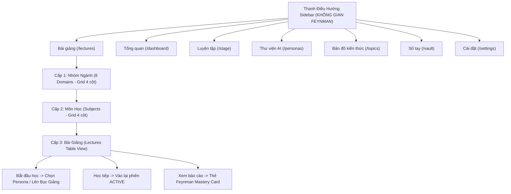

# Kế Hoạch [8]: Cập Nhật Sidebar & Thiết Kế Hệ Thống Bài Giảng 3 Tầng (Three-Tier Lectures System)

> **Trạng thái:** Đã hoàn thành & Kiểm định thành công (Exit Code 0)  
> **Ngày khởi tạo:** 07-11-2026  
> **Mục tiêu cốt lõi:**
> 1. Chuẩn hóa thanh Menu Sidebar thành thương hiệu **"KHÔNG GIAN FEYNMAN"** với chính xác 7 mục điều hướng (bỏ hoàn toàn các nhãn "Bước 1, Bước 2"): `Tổng quan`, `Bài giảng` (`/lectures`), `Luyện tập` (`/stage`), `Thư viện AI` (`/personas`), `Bản đồ kiến thức` (`/topics`), `Sổ tay` (`/vault`), `Cài đặt` (`/settings`).
> 2. Thiết kế lại trang **Bài giảng** (`/lectures`) theo kiến trúc 3 tầng: Cấp 1: Danh sách Nhóm ngành (Grid 4 cột) $\rightarrow$ Cấp 2: Danh sách Môn học (Grid 4 cột 1-2-3-4 / 5-6-7-8) $\rightarrow$ Cấp 3: Danh sách Bài giảng trong Môn (Vertical List/Table view với bộ lọc trạng thái và action buttons).
> 3. Nâng cấp mô hình dữ liệu (`academic_subjects`) và làm giàu bộ dữ liệu Seed mẫu gồm 8 Nhóm ngành, mỗi ngành 4–8 Môn học, mỗi môn 5–10 Bài giảng có sẵn trạng thái (`Đã học`, `Đang học dở`, `Chưa học`, `Cần củng cố`).

---

## 1. Cấu Trúc Điều Hướng & Routing

---

## 2. Chi Tiết Thực Hiện Từng Phân Hệ

### Phân Hệ 1: Cập Nhật Sidebar & Routes
- Cập nhật [`src/config/routes.config.ts`](file:///d:/Theodore/src/config/routes.config.ts):
  - Đổi `STUDY: "/study"` thành `LECTURES: "/lectures"`.
  - Đổi `STAGE: "/stage"`.
  - 7 mục: `LayoutDashboard`, `BookOpen`, `Mic`, `Bot`, `Network`, `Bookmark`, `Settings`.
- Cập nhật [`src/components/layout/AppSidebar.tsx`](file:///d:/Theodore/src/components/layout/AppSidebar.tsx):
  - Header thương hiệu: **"KHÔNG GIAN FEYNMAN"**.
  - Bỏ nhãn "Bước 1, Bước 2".
  - Thêm icon `Bot`, `Bookmark`.
- Cập nhật [`src/App.tsx`](file:///d:/Theodore/src/App.tsx):
  - Tuyến đường `/lectures`, `/lectures/:domainSlug`, `/lectures/:domainSlug/:subjectSlug`.
  - Alias `/stage` $\rightarrow$ redirect hoặc render `StageSetup`.

### Phân Hệ 2: Nâng Cấp Schema & Seed Data
- Cập nhật [`prisma/schema.prisma`](file:///d:/Theodore/prisma/schema.prisma):
  - Bổ sung model `AcademicSubject` với `domainId`, `name`, `slug`, `description`, `orderIndex`, `difficultyLevel`.
  - Bổ sung `subjectId` và `orderIndex` cho `AcademicTopic`.
- Cập nhật [`src/types/catalog.types.ts`](file:///d:/Theodore/src/types/catalog.types.ts):
  - Định nghĩa interface `AcademicSubject` và `LectureStatus` (`NOT_STARTED` | `IN_PROGRESS` | `COMPLETED` | `NEEDS_REVIEW`).
- Xây dựng dữ liệu phong phú tại [`src/data/academic-catalog.data.ts`](file:///d:/Theodore/src/data/academic-catalog.data.ts):
  - 8 Nhóm ngành:
    1. Khoa Học Máy Tính & Kỹ Thuật Phần Mềm
    2. Toán Học Ứng Dụng & Giải Tích
    3. Trí Tuệ Nhân Tạo & Thị Giác Máy Tính
    4. Mạng Máy Tính & Hệ Thống Phân Tán
    5. Kinh Tế Học & Tài Chính Vĩ Mô
    6. Y Sinh Học & Khoa Học Não Bộ
    7. Vật Lý Lượng Tử & Vũ Trụ Học
    8. Khoa Học Dữ Liệu & Thống Kê
  - Mỗi ngành có 4–5 Môn học, mỗi môn có 5–8 Bài giảng với đầy đủ trạng thái và điểm số mẫu.

### Phân Hệ 3: Thiết Kế Giao Diện 3 Tầng Cho `/lectures`
- Component chính: [`src/pages/LecturesExplorer.tsx`](file:///d:/Theodore/src/pages/LecturesExplorer.tsx) (hoặc cụm component trong `src/components/lectures/`):
  - **Thanh Breadcrumb:** `Bài Giảng` > `[Tên Ngành]` > `[Tên Môn]` cho phép quay ngược cấp nhanh 1-click.
  - **Cấp 1 - `DomainGrid`:** Lưới 4 cột, card nhóm ngành hiển thị Icon, Tên ngành, Số môn, Số bài giảng, Thanh tiến độ hoàn thành (%).
  - **Cấp 2 - `SubjectGrid`:** Lưới 4 cột (thứ tự 1 2 3 4 / 5 6 7 8), card môn học hiển thị STT, Tên môn, Mô tả ngắn, Badge độ khó, Tiến độ học `Đã học X/Y bài`.
  - **Cấp 3 - `LectureTableView`:** Danh sách dọc / Table chuẩn, thanh tìm kiếm + bộ lọc trạng thái (`Tất cả`, `Đã học`, `Đang học dở`, `Chưa học`), các cột STT (`01`, `02`), Tiêu đề & Badges từ khóa (`requiredConcepts`), Status Badge, Điểm Clarity, Action buttons (`Bắt đầu học`, `Học tiếp`, `Học lại`, `Xem báo cáo`).
