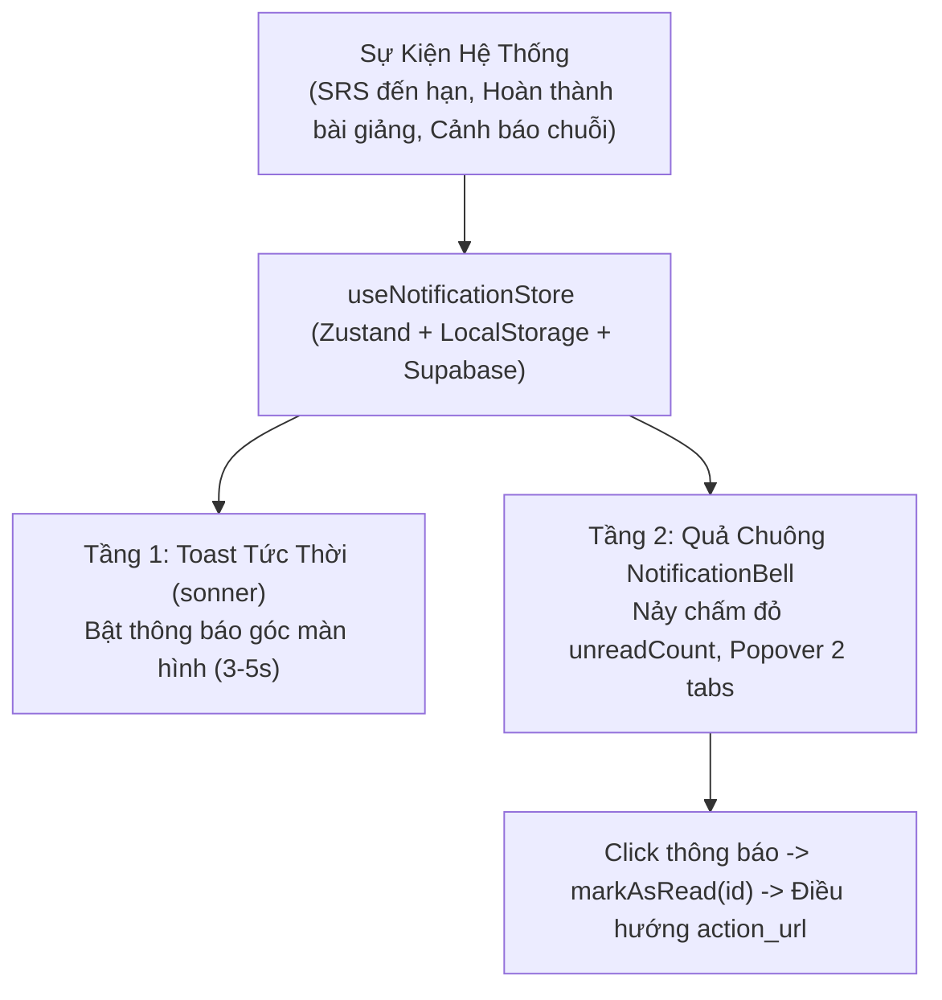

# Kế Hoạch [9]: Hệ Thống Thông Báo 2 Tầng (Two-Tier Notifications System)

> **Trạng thái:** Đã hoàn thành (100%)  
> **Ngày cập nhật:** 07-11-2026  
> **Mục tiêu cốt lõi:**
> 1. Triển khai phân loại thông báo 2 tầng chuẩn:
>    - **Tầng 1 (Tức thời - Toast Sonner):** Thông báo phản hồi nhanh các hành động (Lưu Sổ tay, lỗi Micro/API, mở khóa ẩn dụ, tăng điểm Clarity).
>    - **Tầng 2 (Lưu trữ - In-App Notification Center):** Quả chuông 🔔 trên `TopHeader.tsx` có số đếm đỏ chưa đọc (`unreadCount`), popover 2 tab (*Tất cả* và *Chưa đọc*), nút *Đánh dấu đã đọc tất cả*, điều hướng trực tiếp theo `action_url`.
> 2. Bổ sung bảng thứ 13 `public.notifications` vào Supabase SQL và Prisma Schema với 5 loại thông báo: `SRS_REMINDER`, `SESSION_RESUME`, `REPORT_READY`, `STREAK_ALERT`, `SYSTEM`.
> 3. Cơ chế kích hoạt tự động theo sự kiện (Event-driven) và kiểm tra khi khởi động (On-load/Scheduled check).

---

## 1. Cấu Trúc Bảng Dữ Liệu `notifications` (Bảng thứ 13)

```sql
CREATE TABLE IF NOT EXISTS public.notifications (
    id UUID PRIMARY KEY DEFAULT gen_random_uuid(),
    user_id UUID NOT NULL REFERENCES public.profiles(id) ON DELETE CASCADE,
    type TEXT NOT NULL CHECK (type IN ('SRS_REMINDER', 'SESSION_RESUME', 'REPORT_READY', 'STREAK_ALERT', 'SYSTEM')),
    title TEXT NOT NULL,
    message TEXT NOT NULL,
    action_url TEXT,              -- Đường dẫn khi click (VD: '/vault' hoặc '/stage/123')
    metadata JSONB DEFAULT '{}'::jsonb, -- Dữ liệu phụ (VD: {"topic_id": "...", "modal": "QUICK_DRILL"})
    is_read BOOLEAN DEFAULT FALSE,
    created_at TIMESTAMPTZ DEFAULT NOW()
);

CREATE INDEX IF NOT EXISTS idx_notifications_user_unread 
ON public.notifications(user_id, is_read, created_at DESC);

ALTER PUBLICATION supabase_realtime ADD TABLE public.notifications;
```

---

## 2. Kiến Trúc Luồng Dữ Liệu & Danh Sách File Đã Hoàn Thiện



### Files Mới:
1. `src/types/notification.types.ts`: TypeScript definitions cho `AppNotification`, `NotificationType`, `NotificationMetadata`.
2. `src/hooks/useNotificationStore.ts`: Zustand store quản lý danh sách thông báo, `unreadCount`, `markAsRead`, `markAllAsRead`, `checkSRSDueNotifications`.
3. `src/components/layout/NotificationBell.tsx`: Component quả chuông có badge số đỏ, popover 2 tab (*Tất cả* / *Chưa đọc*), nút *Đánh dấu đã đọc tất cả*, lọc thông minh và điều hướng 1-click.

### Files Đã Tích Hợp:
4. `prisma/schema.prisma`: Bổ sung model `Notification` liên kết 1-nhiều với `Profile`.
5. `supabase/seed.sql`: Chèn DDL `notifications`, index `idx_notifications_user_unread` và dữ liệu seed mẫu.
6. `src/layouts/WorkspaceLayout.tsx`: Gắn `<Toaster position="top-right" richColors closeButton />` từ thư viện `sonner`.
7. `src/components/layout/TopHeader.tsx`: Thay nút chuông tĩnh bằng component `<NotificationBell />`.
8. `src/pages/CommandDashboard.tsx`: Kích hoạt trigger tự động kiểm tra thẻ SM-2 đến hạn ôn tập (`checkSRSDueNotifications`).
9. `src/pages/FeynmanStageLiveRoom.tsx`: Kích hoạt thông báo `REPORT_READY` khi kết thúc bài giảng kèm Toast chúc mừng.
10. `src/pages/AnalogyJargonVault.tsx`: Bổ sung Toast tức thời khi lưu thuật ngữ, sao chép ẩn dụ và ghi nhận điểm SM-2.
11. `src/hooks/useSpeechToText.ts`: Bổ sung Toast cảnh báo lỗi Micro hoặc trình duyệt không hỗ trợ Web Speech API.
